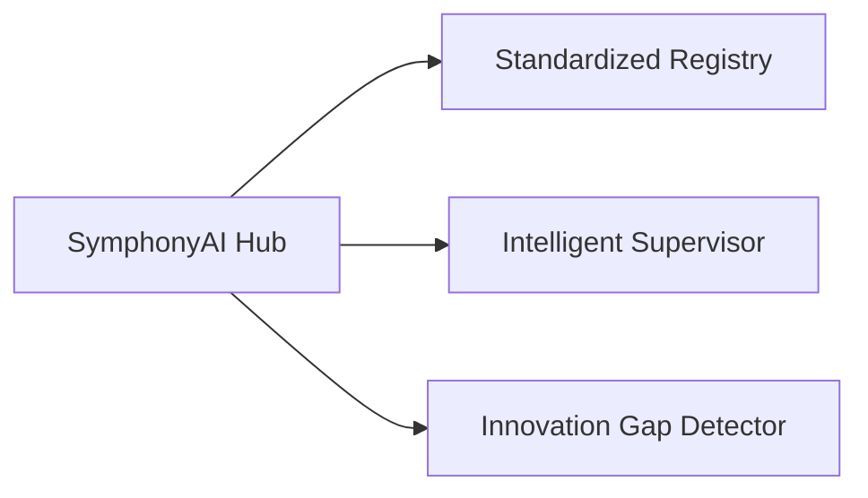

# SymphonyAI — Centralized Enterprise AI Marketplace & Orchestration Hub

SymphonyAI is an intelligent operating system designed to solve the "Agent Sprawl" problem. It serves as a standardized directory, NLP intent-based router, and capability-gap analytics engine for all internal custom employee-built AI tools.

---

## Three Pillars



1. **Standardized AI Registry**: Catalog, verify, and host employee-built AI tools using a uniform `agent-manifest.json` schema.
2. **Intelligent Orchestration (The Supervisor)**: A unified NLP conversational interface routing user requests to specialized tools and sequencing multi-agent pipelines.
3. **Telemetry-Driven Gap Detection**: Aggregating unaddressed user search intents and displaying capability gaps on a live backlog/leaderboard.

---

## Documentation

Comprehensive project and implementation specifications are detailed below:

* **[PRD (Product Requirements Document)](file:///Users/shubhamverma/Documents/JavaProjects/startup/symphonyAI/docs/PRD.md)**: Product goals, non-goals, functional specifications, and user personas.
* **[Architecture Document](file:///Users/shubhamverma/Documents/JavaProjects/startup/symphonyAI/docs/ARCHITECTURE.md)**: System blocks, technology stack choices, and data-flow sequences.
* **[System Design](file:///Users/shubhamverma/Documents/JavaProjects/startup/symphonyAI/docs/SYSTEM_DESIGN.md)**: Database schemas, E-R diagrams, and the `agent-manifest.json` spec.
* **[Security and Access](file:///Users/shubhamverma/Documents/JavaProjects/startup/symphonyAI/docs/SECURITY-AND-ACCESS.md)**: SSO integration, RBAC matrix, and PII masking firewall proxy.
* **[Secrets Management](file:///Users/shubhamverma/Documents/JavaProjects/startup/symphonyAI/docs/SECRETS-MANAGEMENT.md)**: Secrets Vault, credential store, and token rotation.
* **[Roadmap](file:///Users/shubhamverma/Documents/JavaProjects/startup/symphonyAI/docs/ROADMAP.md)**: Breakdown of Phased Implementation (Weeks 1 to 13+).
* **[Frontend Specification](file:///Users/shubhamverma/Documents/JavaProjects/startup/symphonyAI/docs/FRONTEND-SPEC.md)**: Page routes, layout structures, and interface design tokens.

---

## Repository Structure

```
symphonyAI/
├── README.md                     # This file
├── docs/                         # Core project specifications and architecture docs
│   ├── PRD.md
│   ├── product_understanding.md
│   ├── ARCHITECTURE.md
│   ├── SYSTEM_DESIGN.md
│   ├── SECURITY-AND-ACCESS.md
│   ├── SECRETS-MANAGEMENT.md
│   ├── ROADMAP.md
│   ├── FRONTEND-SPEC.md
│   └── implementation-plans/     # Per-feature implementation plans (0001-0006)
├── symphony-backend/             # Spring Boot 3.4.5 / Java 21 gateway
│   └── src/main/
│       ├── java/com/symphony/    # config, controller, dto, entity, repository, service
│       └── resources/
│           ├── application.yml
│           └── db/migration/     # Flyway V1-V5
└── symphony-ui/                  # React 19 + Vite SPA
    └── src/
        ├── App.jsx
        ├── App.css
        └── main.jsx
```

---

## Running Locally

The backend needs PostgreSQL with the `pgvector` and `uuid-ossp` extensions. Flyway applies migrations on boot, and the API listens on port **8091**.

```bash
docker run -d --name symphony-postgres -e POSTGRES_USER=postgres -e POSTGRES_PASSWORD=postgres -e POSTGRES_DB=symphony -p 127.0.0.1:5432:5432 pgvector/pgvector:pg17
```

### Mock mode (local development)

Production behaviour is the default, so a bare `./gradlew bootRun` **refuses to start**. It lists every missing setting at once, and that is intentional. For local work, opt into mock mode:

```bash
cd symphony-backend && SYMPHONY_MOCK_ENABLED=true SYMPHONY_DEV_SEED_PASSWORD='local-dev-password' ./gradlew bootRun
```

Mock mode needs no network access and no API spend:

* **LLM** — embeddings, routing, parameter extraction and gap clustering use deterministic local stand-ins. To use the real OpenAI API while keeping everything else offline, add `SYMPHONY_MOCK_LLM=false OPENAI_API_KEY=…`.
* **Accounts** — three development users are seeded with the password above:

  | Username | Platform role | Corporate roles |
  | :--- | :--- | :--- |
  | `shubham` | ADMIN | Admin, HR |
  | `hr.specialist` | CREATOR | HR |
  | `employee` | USER | Employee |

* **Secrets and signing keys** — held in memory, so agent credentials and sessions are lost on restart. To use a real Vault locally, add `SYMPHONY_VAULT_PROVIDER=hashicorp VAULT_URI=http://localhost:8200 VAULT_TOKEN=…`.
* **Health probes** — skipped, so agents report `ACTIVE`. Set `SYMPHONY_HEARTBEAT_ASSUME_HEALTHY=false` to probe for real.

On startup the application logs a banner listing exactly what the running instance is faking.

### Production

| Variable | Purpose |
| :--- | :--- |
| `OPENAI_API_KEY` | Real OpenAI key |
| `VAULT_URI`, `VAULT_TOKEN` | HashiCorp Vault (KV v2) holding agent credentials and the RS256 JWT key ring |
| `SPRING_DATASOURCE_URL` / `_USERNAME` / `_PASSWORD` | PostgreSQL connection |

If any of these is missing, or a development stand-in is enabled, startup fails with a message listing every problem. See [plan 0007](docs/implementation-plans/0007-production-hardening-blockers.md).

### Frontend and tests

```bash
cd symphony-ui && npm install && npm run dev
```

```bash
cd symphony-backend && ./gradlew test
```

The tests run in mock mode against the database above. The Vault-backed contract tests use a Vault at `localhost:8200` if one is reachable, and are skipped otherwise. [CI](.github/workflows/backend-tests.yml) runs the full suite against Postgres and Vault service containers on every pull request and every push to `main`, and fails if any test is skipped:

```bash
docker run -d --name symphony-vault --cap-add=IPC_LOCK -e VAULT_DEV_ROOT_TOKEN_ID=symphony-dev-root-token -p 127.0.0.1:8200:8200 hashicorp/vault:1.17
```
