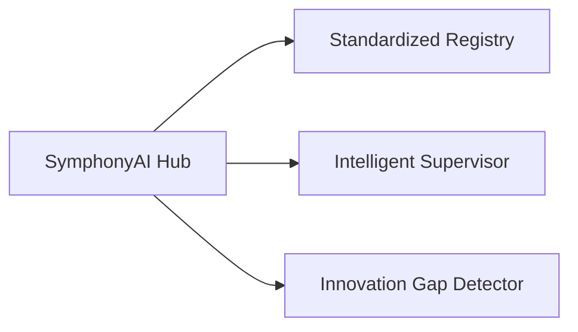

# SymphonyAI — Centralized Enterprise AI Marketplace & Orchestration Hub

SymphonyAI is an intelligent operating system designed to solve the "Agent Sprawl" problem. It serves as a standardized directory, NLP intent-based router, and capability-gap analytics engine for all internal custom employee-built AI tools.

---

## Three Pillars



1. **Standardized AI Registry**: Catalog, verify, and host employee-built AI tools using a uniform `agent-manifest.json` schema.
2. **Intelligent Orchestration (The Supervisor)**: A unified NLP conversational interface routing user requests to specialized tools and sequencing multi-agent pipelines.
3. **Telemetry-Driven Gap Detection**: Aggregating unaddressed user search intents and displaying capability gaps on a live backlog/leaderboard.

---

## Documentation

Comprehensive project and implementation specifications are detailed below:

* **[PRD (Product Requirements Document)](file:///Users/shubhamverma/Documents/JavaProjects/startup/symphonyAI/docs/PRD.md)**: Product goals, non-goals, functional specifications, and user personas.
* **[Architecture Document](file:///Users/shubhamverma/Documents/JavaProjects/startup/symphonyAI/docs/ARCHITECTURE.md)**: System blocks, technology stack choices, and data-flow sequences.
* **[System Design](file:///Users/shubhamverma/Documents/JavaProjects/startup/symphonyAI/docs/SYSTEM_DESIGN.md)**: Database schemas, E-R diagrams, and the `agent-manifest.json` spec.
* **[Security and Access](file:///Users/shubhamverma/Documents/JavaProjects/startup/symphonyAI/docs/SECURITY-AND-ACCESS.md)**: SSO integration, RBAC matrix, and PII masking firewall proxy.
* **[Secrets Management](file:///Users/shubhamverma/Documents/JavaProjects/startup/symphonyAI/docs/SECRETS-MANAGEMENT.md)**: Secrets Vault, credential store, and token rotation.
* **[Roadmap](file:///Users/shubhamverma/Documents/JavaProjects/startup/symphonyAI/docs/ROADMAP.md)**: Breakdown of Phased Implementation (Weeks 1 to 13+).
* **[Frontend Specification](file:///Users/shubhamverma/Documents/JavaProjects/startup/symphonyAI/docs/FRONTEND-SPEC.md)**: Page routes, layout structures, and interface design tokens.

---

## Repository Structure

```
symphonyAI/
├── README.md                # This file
└── docs/                    # Core project specifications and architecture docs
    ├── PRD.md
    ├── ARCHITECTURE.md
    ├── SYSTEM_DESIGN.md
    ├── SECURITY-AND-ACCESS.md
    ├── SECRETS-MANAGEMENT.md
    ├── ROADMAP.md
    └── FRONTEND-SPEC.md
```
