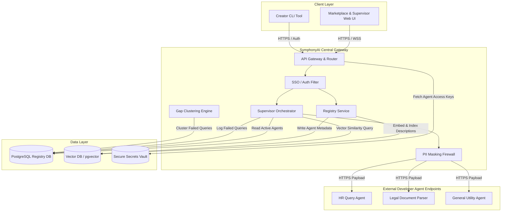
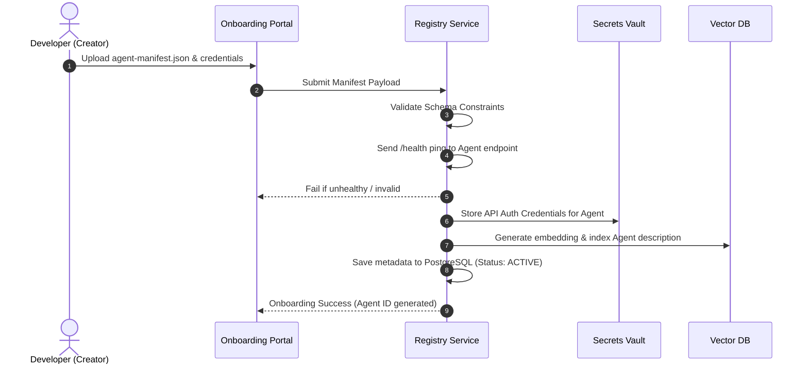
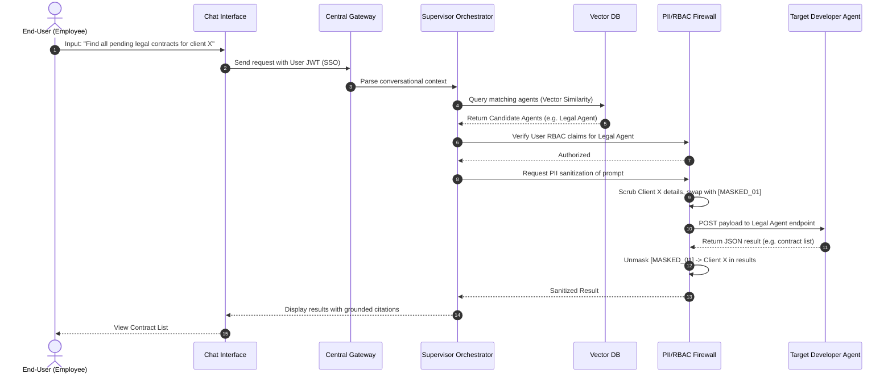

# SymphonyAI — High-Level Architecture Spec

This document details the high-level architecture, system blocks, data-flow pipelines, and tech-stack mapping for the SymphonyAI platform.

---

## 1. System Block Diagram

The following architecture diagram represents the core subsystems of SymphonyAI and how they interact:

---

## 2. Core Subsystems

### 2.1 The Smart Registry Service
Manages onboarding and lifecycle events for custom developer agents. It parses the uploaded `agent-manifest.json`, validates its JSON schema constraints, runs a loopback `/health` check against the agent's endpoint, and indexes the semantic definition (e.g. system instructions, description) in pgvector.

### 2.2 The Supervisor Orchestrator
The central NLP router. It converts user queries into vector embeddings, performs similarity lookups in pgvector to find candidate agents, and runs an LLM tool-calling logic step to determine:
1. **Single-Agent Routing**: Directly formatting and dispatching the payload to the matching agent.
2. **Multi-Agent Pipeline Chaining**: Sequencing execution (e.g. running Agent A, mapping its output parameters, and feeding them to Agent B).
3. **No-Match Refusal**: Logging the query as unaddressed and returning a graceful refusal to the user.

### 2.3 The PII & RBAC Firewall Proxy
Acts as a security filter shielding developer agent endpoints:
* **RBAC checking**: Validates user JWT claims and Single Sign-On (SSO) attributes against the registry rules for the target agent.
* **PII Masking**: Sanitizes the prompt (identifying credit card numbers, SSNs, phone numbers, and names) and swaps them with masked tokens before forwarding the request.

### 2.4 The Telemetry & Gap Detector Engine
A background service that processes telemetry. It reads unaddressed or failed query logs from PostgreSQL, processes them using a lightweight text-clustering pipeline (e.g. TF-IDF + K-Means or LLM summarization), and groups them into prioritized feature gaps.

---

## 3. Data Flow Sequences

### 3.1 Agent Onboarding Flow

### 3.2 Conversational Routing & Execution Flow

---

## 4. Technology Stack Mapping

* **Backend Services**: Java / Spring Boot (Spring WebFlux for streaming responses and high concurrency, Spring Security for SSO/OAuth).
* **Primary Relational DB**: PostgreSQL (retains user tables, agent metadata registry tables, logs, and telemetry).
* **Vector DB Engine**: pgvector extension on PostgreSQL (cos-similarity matching on agent manifests).
* **Secrets Storage**: HashiCorp Vault or Google Secret Manager (storing API keys for external developer agents).
* **LLM Engine**: OpenAI API (`gpt-4o-mini` for intent routing/chaining decisions, `text-embedding-3-small` for search embeddings).
