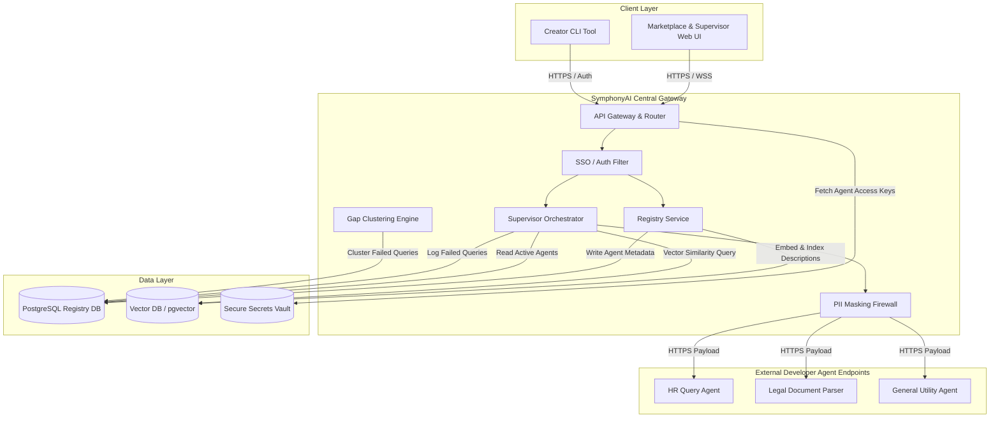
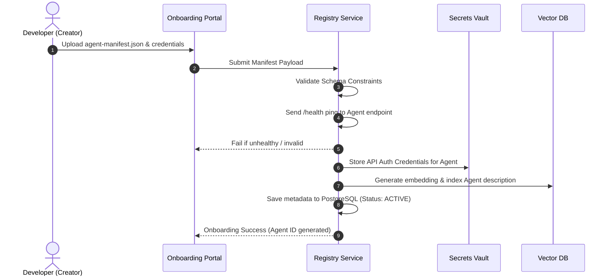
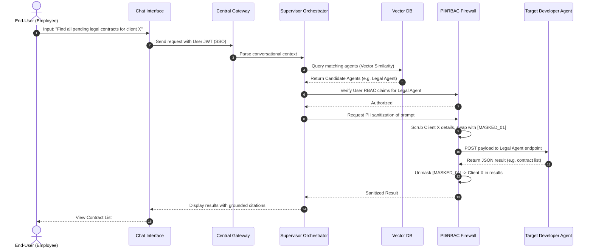

# SymphonyAI — High-Level Architecture Spec

This document details the high-level architecture, system blocks, data-flow pipelines, and tech-stack mapping for the SymphonyAI platform.

---

## 1. System Block Diagram

The following architecture diagram represents the core subsystems of SymphonyAI and how they interact:

---

## 2. Core Subsystems

### 2.1 The Smart Registry Service
Manages onboarding and lifecycle events for custom developer agents. It parses the uploaded `agent-manifest.json`, validates its JSON schema constraints, runs a loopback `/health` check against the agent's endpoint, and indexes the semantic definition (e.g. system instructions, description) in pgvector.

### 2.2 The Supervisor Orchestrator
The central NLP router. It converts user queries into vector embeddings, performs similarity lookups in pgvector to find candidate agents, and runs an LLM tool-calling logic step to determine:
1. **Single-Agent Routing**: Directly formatting and dispatching the payload to the matching agent.
2. **Multi-Agent Pipeline Chaining**: Sequencing execution (e.g. running Agent A, mapping its output parameters, and feeding them to Agent B).
3. **No-Match Refusal**: Logging the query as unaddressed and returning a graceful refusal to the user.

### 2.3 The PII & RBAC Firewall Proxy
Acts as a security filter shielding developer agent endpoints:
* **RBAC checking**: Validates user JWT claims and Single Sign-On (SSO) attributes against the registry rules for the target agent.
* **PII Masking**: Sanitizes the prompt (identifying credit card numbers, SSNs, phone numbers, and names) and swaps them with masked tokens before forwarding the request.

### 2.4 The Telemetry & Gap Detector Engine
A background service that processes telemetry. It reads unaddressed or failed query logs from PostgreSQL, processes them using a lightweight text-clustering pipeline (e.g. TF-IDF + K-Means or LLM summarization), and groups them into prioritized feature gaps.

---

## 3. Data Flow Sequences

### 3.1 Agent Onboarding Flow

### 3.2 Conversational Routing & Execution Flow

---

## 4. Technology Stack Mapping

The table separates what is **implemented today** from what the target architecture calls for, so the two are not conflated.

| Concern | Implemented today | Target / planned |
| :--- | :--- | :--- |
| **Backend runtime** | Java 21, Spring Boot 3.4.5, `spring-boot-starter-web` (blocking Servlet MVC), Spring Security, Spring Data JPA | Spring WebFlux (or MVC on virtual threads) for streamed Supervisor responses and high fan-out agent calls |
| **Outbound HTTP** | OkHttp 4.12.0 (agent calls, OpenAI calls, heartbeat pings) | Unchanged; add per-agent circuit breakers and bulkheads |
| **Relational DB** | PostgreSQL via JPA, `ddl-auto: validate`, Flyway `V1`–`V5` | Unchanged |
| **Vector engine** | pgvector on the same PostgreSQL instance, HNSW cosine index on `agents.description_embedding` | Unchanged |
| **Secrets storage** | `SecretsVaultService`, selected by `symphony.vault.provider`. `HashiCorpSecretsVaultService` (HashiCorp Vault KV v2 via `spring-vault-core`) is the default outside mock mode and survives restarts. `LocalSecretsVaultService` is an in-memory, non-durable store for local development only; the startup guard refuses it in production. | GCP / AWS Secrets Manager as further implementations of the same interface; AppRole auth instead of a static token |
| **PII token store** | `PiiFirewallService` returns a per-request `FirewallResult.tokenMap` held in request scope for the duration of the call | Encrypted Redis session cache with a 15-minute TTL, per `SECURITY-AND-ACCESS.md` §3.3 |
| **Auth** | `POST /api/v1/auth/login` verifies a BCrypt password. Roles and workspace come from the database: corporate roles from `users.corporate_roles`, platform role from `users.role_flag`. Issues an RS256 JWT with a `kid` header, signed from a key ring kept in Vault. Retired keys keep verifying for a 24h overlap. | Corporate SSO (OIDC/OAuth 2.0) code exchange, as specced in `SECURITY-AND-ACCESS.md` §1; scheduled key rotation |
| **LLM engine** | OpenAI API: `gpt-4o-mini` for routing/DAG planning and parameter extraction, `text-embedding-3-small` for embeddings. When `symphony.mock.llm` is true (it follows `symphony.mock.enabled` unless set), deterministic local stand-ins are used instead. The startup guard refuses a mocked LLM in production. | Provider-agnostic abstraction |
| **Frontend** | React 19 + Vite SPA, single `App.jsx` with `view`-state switching, vanilla CSS ("Alabaster & Obsidian") | Client-side router matching the paths in `FRONTEND-SPEC.md` §2 |
| **Scheduling** | Spring `@EnableScheduling`; `AgentHeartbeatService.runHeartbeatCheck()` at `symphony.heartbeat.interval-ms` (default 30s). Probes every agent with a health URL; `symphony.heartbeat.assume-healthy` skips probing (default: follows mock mode) | Distributed-lock-guarded scheduling so only one instance probes per interval; the same lock would let JWT key rotation run on a timer |
| **Not yet present** | — | Creator CLI tool, Redis, message broker, dedicated Gap-clustering worker process (clustering currently runs in-process in `GapClusteringService`) |

### 4.1 Implemented API Surface

| Method | Path | Notes |
| :--- | :--- | :--- |
| `POST` | `/api/v1/auth/login` | Issues platform JWT |
| `POST` | `/api/v1/agents/onboard` | Manifest validation, `/health` probe, embedding, vault write |
| `GET` | `/api/v1/agents` | Workspace-scoped registry listing |
| `POST` | `/api/v1/agents/search` | Semantic (pgvector cosine) agent search |
| `POST` | `/api/v1/supervisor/chat` | Intent routing, DAG chaining, RBAC + PII firewall, telemetry |
| `GET` | `/api/v1/admin/gaps` | Clustered innovation-gap leaderboard |
| `GET` | `/api/v1/admin/telemetry` | Aggregate execution telemetry |
| `GET` | `/api/v1/admin/billing/stats` | Department token-cost allocation |
| `GET` | `/api/v1/admin/billing/audit` | Per-execution billing audit rows |
| `POST` | `/api/v1/admin/gaps/trigger-cluster` | Manually trigger gap clustering |

### 4.2 Known Divergences from the Diagrams Above

* The **Client Layer** diagram shows a Creator CLI tool; only the web UI exists today.
* The **Gap Clustering Engine** is drawn as a separate background service; it is currently a Spring bean (`GapClusteringService`) inside the same process, invokable on demand via `POST /api/v1/admin/gaps/trigger-cluster`.
* The onboarding and routing sequence diagrams show a dedicated **PII/RBAC Firewall** hop. In code, RBAC checks and `PiiFirewallService` calls are invoked inline from `SupervisorService` rather than crossing a process or network boundary.
* Startup validation (`ConfigurationGuard`) runs before any bean is created. In production mode it refuses to start on a missing OpenAI key, a mocked LLM, an in-memory vault, or missing Vault connection settings, and lists every problem in one message. In mock mode it logs a banner naming exactly what the instance is faking.
