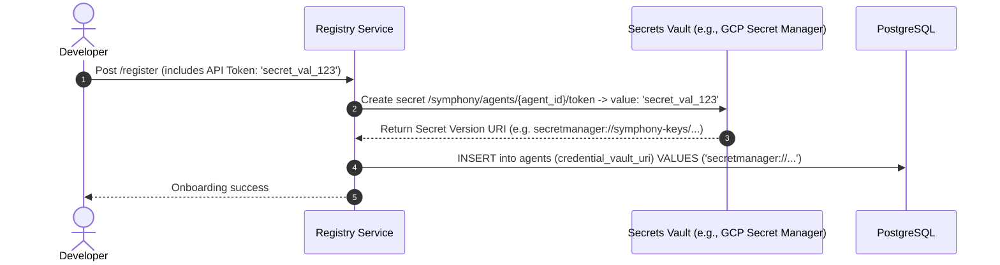

# SymphonyAI — Secrets Management Specification

This document details how SymphonyAI manages, stores, and rotates sensitive credentials (such as API keys, SSO secret keys, Database passwords, and developer agent credentials).

---

## 1. Secrets Architecture Overview

SymphonyAI interacts with multiple decentralized, developer-hosted agents. To securely authenticate routing requests without exposing developer tokens to other workspace members:

* All agent-specific credentials (tokens, bearer keys, basic auth headers) are stored in an **Encrypted Secrets Vault** (e.g., HashiCorp Vault, AWS Secrets Manager, or Google Secret Manager).
* Database entries do **not** store plaintext keys. The `agents` table only holds a reference URI pointing to the secret stored in the vault.
* Platform configuration credentials (database credentials, JWT private signing key, OIDC client secrets, LLM API keys) are injected into the platform container environment at runtime.

---

## 2. Vault Integration Design

The diagram below highlights the flow of registering and retrieving a developer agent's credential token:

### 2.1 Retrieval Flow (During Execution)
1. The **Supervisor Router** selects Agent X for execution.
2. The **Gateway Router** fetches the `credential_vault_uri` from the PostgreSQL `agents` table.
3. The Gateway invokes the Secrets Vault client to fetch the credentials corresponding to that URI.
4. The credentials are cached in-memory (using a secure, transient cache) for the duration of that single transaction and are injected as an `Authorization: Bearer <token>` header into the outgoing payload.
5. Once the HTTP transaction completes, the decrypted token is immediately purged from memory.

---

## 3. Database Column-Level Encryption

To defend against SQL injection data dumps or compromised database backups, SymphonyAI encrypts sensitive text columns in PostgreSQL at the application layer before writing to the database:

* **Encryption Standard**: Advanced Encryption Standard in Galois/Counter Mode (**AES-256-GCM**), which provides both confidentiality and data integrity (authenticated encryption).
* **Target Columns**: 
  * `telemetry_logs.query_text` (Contains user prompts, potentially including sensitive corporate info).
  * `failed_queries.raw_query` (Contains raw searches that failed).
  * `workspace_members.joined_at` and `users.email` (For PII compliance).
* **Key Derivation**: Keys are derived from a master encryption key stored in the corporate Secrets Vault and loaded into the Spring Boot application configuration at boot time.

---

## 4. Key Rotation & Expiration Policies

* **Master Signing Key Rotation**: The JWT private signing key must be rotated automatically every **90 days**. SymphonyAI retains the previous key for 24 hours to support graceful session drainage.
* **Agent Secret Rotation Webhook**: Creators can request rotation of their registered agent API key via `POST /api/v1/agents/{agent_id}/rotate-secret`. This updates the entry in the Secrets Vault and increments the agent's `concurrency_version`.
* **Zero-Downtime Verification**: During credential rotation, the Registry service runs a loopback test using the new credential against the agent's `/health` endpoint before committing it to the vault. If the health check fails, the rotation rolls back to the previous key.
