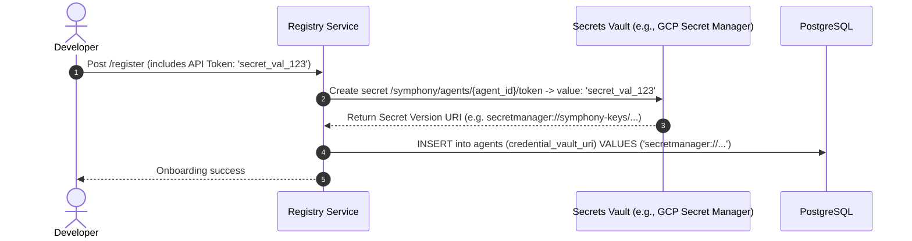

# SymphonyAI — Secrets Management Specification

This document details how SymphonyAI manages, stores, and rotates sensitive credentials (such as API keys, SSO secret keys, Database passwords, and developer agent credentials).

---

## 1. Secrets Architecture Overview

SymphonyAI interacts with multiple decentralized, developer-hosted agents. To securely authenticate routing requests without exposing developer tokens to other workspace members:

* All agent-specific credentials (tokens, bearer keys, basic auth headers) are stored in an **Encrypted Secrets Vault** (e.g., HashiCorp Vault, AWS Secrets Manager, or Google Secret Manager).
* Database entries do **not** store plaintext keys. The `agents` table only holds a reference URI pointing to the secret stored in the vault.
* Platform configuration credentials (database credentials, JWT private signing key, OIDC client secrets, LLM API keys) are injected into the platform container environment at runtime.

---

## 2. Vault Integration Design

The diagram below highlights the flow of registering and retrieving a developer agent's credential token:

### 2.1 Retrieval Flow (During Execution)
1. The **Supervisor Router** selects Agent X for execution.
2. The **Gateway Router** fetches the `credential_vault_uri` from the PostgreSQL `agents` table.
3. The Gateway invokes the Secrets Vault client to fetch the credentials corresponding to that URI.
4. The credentials are cached in-memory (using a secure, transient cache) for the duration of that single transaction and are injected as an `Authorization: Bearer <token>` header into the outgoing payload.
5. Once the HTTP transaction completes, the decrypted token is immediately purged from memory.

---

## 3. Database Column-Level Encryption

To defend against SQL injection data dumps or compromised database backups, SymphonyAI encrypts sensitive text columns in PostgreSQL at the application layer before writing to the database:

* **Encryption Standard**: Advanced Encryption Standard in Galois/Counter Mode (**AES-256-GCM**), which provides both confidentiality and data integrity (authenticated encryption).
* **Mechanism**: `AesGcmEncryptor` is a JPA `AttributeConverter<String, String>` applied per field with `@Convert`, so encryption and decryption happen transparently on the entity boundary. A fresh 12-byte IV is generated per write and prepended to the ciphertext, and the result is base64-encoded — which is why `V4__increase_query_text_columns_length.sql` widens the affected columns to `TEXT`.
* **Encrypted today**:
  * `telemetry_logs.query_text` — user prompts, potentially including sensitive corporate info (`TelemetryLog.queryText`).
  * `failed_queries.raw_query` — raw searches that yielded no agent match (`FailedQuery.rawQuery`).
* **Not yet encrypted (planned)**:
  * `users.email` — requires a deterministic or blind-index scheme, because the column carries a `UNIQUE` constraint and is looked up by exact value during login. A randomised-IV GCM converter would break both.
* **Explicitly out of scope**: `workspace_members.joined_at`. An earlier revision of this document listed it as a target; it is a timestamp carrying no PII, and encrypting it to a string column would destroy range queries and ordering for no privacy gain.
* **Key Derivation**: Keys are derived from a master encryption key stored in the corporate Secrets Vault and loaded into the Spring Boot application configuration at boot time.

> **Current implementation status**: `symphony.vault.provider` chooses the `SecretsVaultService` implementation. **`hashicorp`** (the default outside mock mode) is `HashiCorpSecretsVaultService`. It stores credentials in a Vault KV v2 mount, and they survive restarts. Stored URIs record the mount (`vault://secret/<path>`), so changing the configured mount cannot silently redirect reads. **`local`** (the default in mock mode) is `LocalSecretsVaultService`: AES-256-GCM ciphertext in an in-process map, lost on restart, for local development only. The startup guard refuses the local provider in production. Onboarding reads each credential back right after storing it, and marks the agent `UNHEALTHY` if it cannot be resolved. That surfaces a storage failure at registration, rather than later as an unexplained 401 from the agent.

---

## 4. Key Rotation & Expiration Policies

* **Master Signing Key Rotation**: The JWT private signing key must be rotated automatically every **90 days**. SymphonyAI retains the previous key for 24 hours to support graceful session drainage.
  * **Implementation status**: the mechanism is implemented. Tokens are RS256, and the `kid` header tells the verifier which key signed them. `JwtKeyProvider.rotate()` generates a new signing key and retires the current one. Retired keys keep only their public half and verify for `symphony.jwt.rotation-overlap-hours` (default 24), then are pruned. The ring is persisted to Vault at `symphony.jwt.vault-path`, so replicas share it and restarts keep sessions valid. **Automatic rotation on a timer is not yet enabled**: each replica runs its own scheduler, so timed rotation needs a distributed lock to stop replicas rotating independently. Until then, rotation is an operator action. A warning is logged at startup when the active key is older than `symphony.jwt.rotation-period-days` (default 90).
* **Agent Secret Rotation Webhook**: Creators can request rotation of their registered agent API key via `POST /api/v1/agents/{agent_id}/rotate-secret`. This updates the entry in the Secrets Vault and increments the agent's `concurrency_version`.
* **Zero-Downtime Verification**: During credential rotation, the Registry service runs a loopback test using the new credential against the agent's `/health` endpoint before committing it to the vault. If the health check fails, the rotation rolls back to the previous key.
