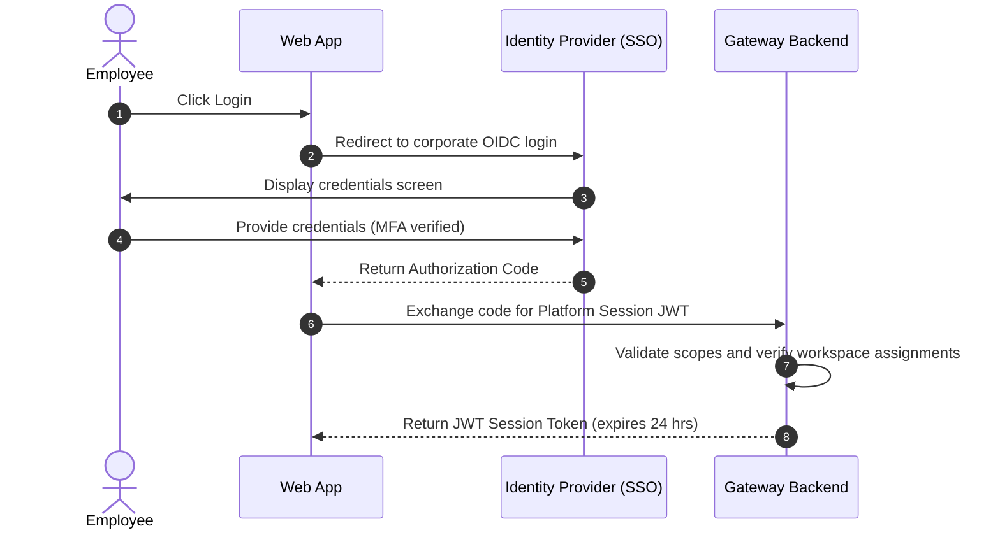
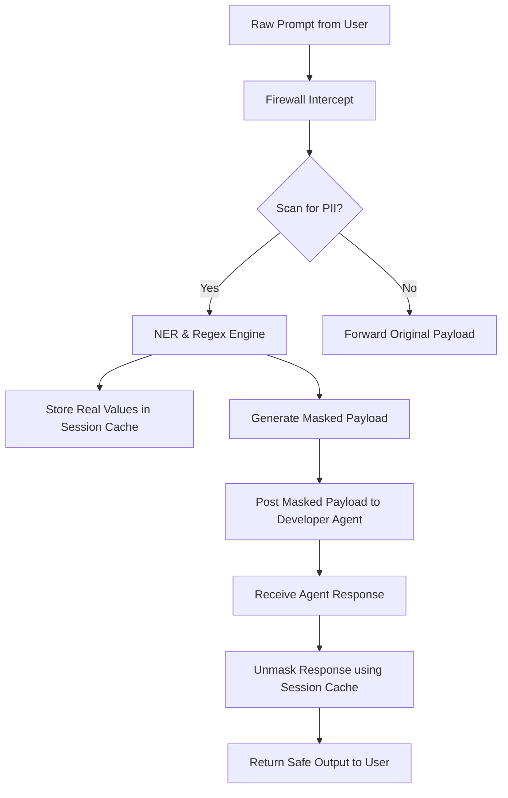

# SymphonyAI — Security, SSO, and Governance Specification

This document details the security and governance architecture of SymphonyAI, including SSO integrations, Role-Based Access Control (RBAC) boundaries, and the PII Masking Firewall Proxy.

---

## 1. Single Sign-On (SSO) & Session Authentication

SymphonyAI enforces centralized authentication via corporate Single Sign-On (SSO) using OpenID Connect (OIDC) or OAuth 2.0.



### Session JWT Payload Example
```json
{
  "iss": "symphony-ai.internal",
  "sub": "usr_90f23b2e88a0",
  "name": "Jane Doe",
  "email": "jane.doe@enterprise.com",
  "roles": ["HR_ADMIN", "REGIONAL_MANAGER"],
  "assigned_workspaces": [
    {
      "workspace_id": "ws_d8923a102e3b",
      "membership_role": "EDITOR"
    }
  ],
  "exp": 1783584000
}
```

---

## 2. Authorization & RBAC Matrix

SymphonyAI separates permissions into two distinct layers:
1. **Workspace Scope**: Defines what operations a user can perform *within the platform registry and telemetry views*.
2. **Agent Access Scope**: Defines if a user's corporate SSO identity roles grant permission to *route payloads to a specific registered agent*.

### 2.1 Workspace Membership Role Boundaries
* **OWNER**: Full administrative control. Can add/remove members, update workspace billing/settings, register or delete any agent, and view all token costs and audit trails.
* **EDITOR**: Technical onboarding role. Can upload/update agent manifests, register new endpoints, and inspect execution telemetry for their own agents.
* **VIEWER**: End-user employee role. Can search the marketplace and initiate conversations with the Supervisor router, but cannot modify manifests, view administrative telemetry, or change settings.

### 2.2 Agent-Level Access Validation Flow
When the Supervisor routes a query to an agent whose manifest sets `security.requiresRBAC = true`, the PII/RBAC Firewall intercepts:
1. The firewall extracts the user's `roles` array from their session JWT.
2. The firewall evaluates the user's roles against the agent's registered `authorizedRoles` array.
3. If an intersection exists (e.g. `roles` contains `"HR_ADMIN"` and `authorizedRoles` allows `"HR_ADMIN"`), the request is forwarded.
4. If no matching role is found, the firewall drops the request and returns a `403 Forbidden` response. The Supervisor translates this to a polite refusal in the chat interface.

---

## 3. PII & Data Protection Firewall

To protect employee privacy and keep proprietary data secure, the platform intercepts prompt payloads sent to third-party or developer-hosted agent endpoints.



### 3.1 Masking Algorithm
1. **NER Scan**: Utilizes standard Named Entity Recognition models to identify:
   * Personally Identifiable Information: `NAME`, `EMAIL`, `PHONE`, `SSN`.
   * Sensitive Corporate Info: `CREDIT_CARD`, `BANK_ACCOUNT`, `IP_ADDRESS`.
2. **Tokenization**: Replaces matching text strings with unique, serialized tokens:
   * *"Send salary sheet of Jane Doe to hr-agent@enterprise.com"* $\rightarrow$ *"Send salary sheet of `[MASKED_NAME_01]` to `[MASKED_EMAIL_01]`"*.
3. **Session Cache**: Stores the mapping `{ "[MASKED_NAME_01]": "Jane Doe", "[MASKED_EMAIL_01]": "hr-agent@enterprise.com" }` in an encrypted Redis session cache with a Time-To-Live (TTL) of 15 minutes.
4. **Response Detokenization**: Before rendering the response back to the user, the PII Proxy maps any occurring `[MASKED_XX]` tags back to their raw cached strings.

---

## 4. Multi-Tenant Hard Isolation

To prevent information leaks between separate organizational entities or business groups:
* All database queries verifying or retrieving agents, telemetry, or logs MUST include a hard-coded `workspace_id` predicate:
  ```sql
  SELECT * FROM agents WHERE id = ? AND workspace_id = ?;
  ```
* Attempting to query or execute an agent belonging to a different workspace yields a `404 Not Found` error rather than a `403 Forbidden` error, ensuring the platform does not leak the existence of unauthorized resources.
