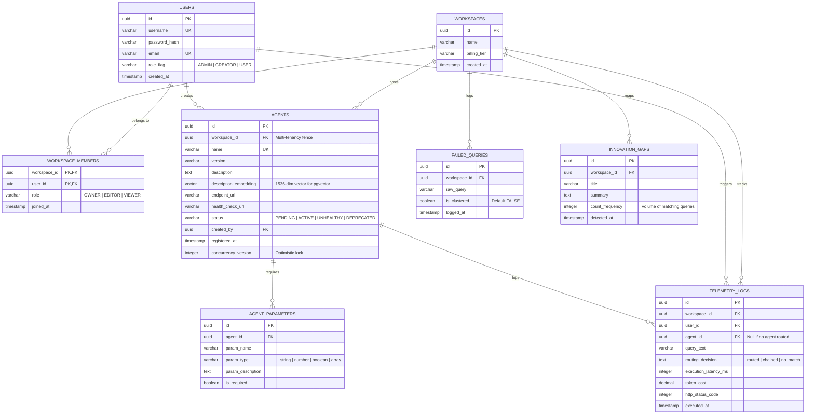

# SymphonyAI — System Design & Database Schema Spec

This document details the database schema design, Entity-Relationship model, and the specifications for the agent manifest format.

---

## 1. Entity-Relationship (E-R) Diagram

SymphonyAI uses a PostgreSQL database with the `pgvector` extension. The logical data layout is structured as follows:



---

## 2. Relational Schema DDL Reference

```sql
-- Extensions
CREATE EXTENSION IF NOT EXISTS "uuid-ossp";
CREATE EXTENSION IF NOT EXISTS "vector";

-- Users Table
CREATE TABLE users (
    id UUID PRIMARY KEY DEFAULT uuid_generate_v4(),
    username VARCHAR(100) UNIQUE NOT NULL,
    password_hash VARCHAR(255) NOT NULL,
    email VARCHAR(150) UNIQUE NOT NULL,
    role_flag VARCHAR(20) NOT NULL CHECK (role_flag IN ('ADMIN', 'CREATOR', 'USER')),
    created_at TIMESTAMP WITH TIME ZONE DEFAULT CURRENT_TIMESTAMP
);

-- Workspaces Table
CREATE TABLE workspaces (
    id UUID PRIMARY KEY DEFAULT uuid_generate_v4(),
    name VARCHAR(100) NOT NULL,
    billing_tier VARCHAR(50) DEFAULT 'FREE',
    created_at TIMESTAMP WITH TIME ZONE DEFAULT CURRENT_TIMESTAMP
);

-- Workspace Membership Table (Joint RBAC/Multi-tenancy mapping)
CREATE TABLE workspace_members (
    workspace_id UUID REFERENCES workspaces(id) ON DELETE CASCADE,
    user_id UUID REFERENCES users(id) ON DELETE CASCADE,
    role VARCHAR(20) NOT NULL CHECK (role IN ('OWNER', 'EDITOR', 'VIEWER')),
    joined_at TIMESTAMP WITH TIME ZONE DEFAULT CURRENT_TIMESTAMP,
    PRIMARY KEY (workspace_id, user_id)
);

-- Agents Table
CREATE TABLE agents (
    id UUID PRIMARY KEY DEFAULT uuid_generate_v4(),
    workspace_id UUID NOT NULL REFERENCES workspaces(id) ON DELETE CASCADE,
    name VARCHAR(100) NOT NULL,
    version VARCHAR(20) NOT NULL,
    description TEXT NOT NULL,
    description_embedding vector(1536), -- Dimension matches text-embedding-3-small
    endpoint_url VARCHAR(255) NOT NULL,
    health_check_url VARCHAR(255),
    status VARCHAR(20) DEFAULT 'PENDING' CHECK (status IN ('PENDING', 'ACTIVE', 'UNHEALTHY', 'DEPRECATED')),
    created_by UUID REFERENCES users(id) ON DELETE SET NULL,
    registered_at TIMESTAMP WITH TIME ZONE DEFAULT CURRENT_TIMESTAMP,
    concurrency_version INTEGER DEFAULT 0 NOT NULL,
    CONSTRAINT unique_workspace_agent_name UNIQUE (workspace_id, name)
);

-- Agent Parameters Table
CREATE TABLE agent_parameters (
    id UUID PRIMARY KEY DEFAULT uuid_generate_v4(),
    agent_id UUID NOT NULL REFERENCES agents(id) ON DELETE CASCADE,
    param_name VARCHAR(100) NOT NULL,
    param_type VARCHAR(20) NOT NULL CHECK (param_type IN ('string', 'number', 'boolean', 'array')),
    param_description TEXT,
    is_required BOOLEAN DEFAULT FALSE,
    CONSTRAINT unique_agent_param UNIQUE (agent_id, param_name)
);

-- Telemetry Logs
CREATE TABLE telemetry_logs (
    id UUID PRIMARY KEY DEFAULT uuid_generate_v4(),
    workspace_id UUID NOT NULL REFERENCES workspaces(id) ON DELETE CASCADE,
    user_id UUID REFERENCES users(id) ON DELETE SET NULL,
    agent_id UUID REFERENCES agents(id) ON DELETE SET NULL,
    query_text VARCHAR(500) NOT NULL,
    routing_decision VARCHAR(20) NOT NULL CHECK (routing_decision IN ('routed', 'chained', 'no_match')),
    execution_latency_ms INTEGER,
    token_cost DECIMAL(10, 6) DEFAULT 0.000000,
    http_status_code INTEGER,
    executed_at TIMESTAMP WITH TIME ZONE DEFAULT CURRENT_TIMESTAMP
);

-- Failed Queries
CREATE TABLE failed_queries (
    id UUID PRIMARY KEY DEFAULT uuid_generate_v4(),
    workspace_id UUID NOT NULL REFERENCES workspaces(id) ON DELETE CASCADE,
    raw_query VARCHAR(500) NOT NULL,
    is_clustered BOOLEAN DEFAULT FALSE,
    logged_at TIMESTAMP WITH TIME ZONE DEFAULT CURRENT_TIMESTAMP
);

-- Innovation Gaps
CREATE TABLE innovation_gaps (
    id UUID PRIMARY KEY DEFAULT uuid_generate_v4(),
    workspace_id UUID NOT NULL REFERENCES workspaces(id) ON DELETE CASCADE,
    title VARCHAR(150) NOT NULL,
    summary TEXT,
    count_frequency INTEGER DEFAULT 1,
    detected_at TIMESTAMP WITH TIME ZONE DEFAULT CURRENT_TIMESTAMP
);

-- Indices
CREATE INDEX idx_agents_embedding ON agents USING hnsw (description_embedding vector_cosine_ops);
CREATE INDEX idx_telemetry_workspace ON telemetry_logs (workspace_id);
CREATE INDEX idx_failed_queries_unclustered ON failed_queries (workspace_id) WHERE is_clustered = FALSE;
```

---

## 3. Agent Manifest Specification (`agent-manifest.json`)

To register an agent, the creator must upload a JSON manifest that complies with the schema below.

### 3.1 Manifest JSON Schema
```json
{
  "$schema": "http://json-schema.org/draft-07/schema#",
  "title": "AgentManifest",
  "type": "object",
  "properties": {
    "manifestVersion": { "type": "string", "enum": ["1.0"] },
    "name": { "type": "string", "pattern": "^[a-z0-9-]{3,50}$" },
    "version": { "type": "string", "pattern": "^\\d+\\.\\d+\\.\\d+$" },
    "description": { "type": "string", "minLength": 10, "maxLength": 1000 },
    "endpoints": {
      "type": "object",
      "properties": {
        "execution": { "type": "string", "format": "uri" },
        "health": { "type": "string", "format": "uri" }
      },
      "required": ["execution", "health"]
    },
    "parameters": {
      "type": "array",
      "items": {
        "type": "object",
        "properties": {
          "name": { "type": "string", "pattern": "^[a-zA-Z_][a-zA-Z0-9_]*$" },
          "type": { "type": "string", "enum": ["string", "number", "boolean", "array"] },
          "description": { "type": "string" },
          "required": { "type": "boolean" }
        },
        "required": ["name", "type", "description", "required"]
      }
    },
    "security": {
      "type": "object",
      "properties": {
        "requiresRBAC": { "type": "boolean" },
        "authorizedRoles": {
          "type": "array",
          "items": { "type": "string" }
        }
      },
      "required": ["requiresRBAC"]
    }
  },
  "required": ["manifestVersion", "name", "version", "description", "endpoints", "parameters", "security"]
}
```

### 3.2 Sample Manifest File
```json
{
  "manifestVersion": "1.0",
  "name": "legal-contract-analyzer",
  "version": "1.2.0",
  "description": "Parses enterprise contract agreements to identify missing clauses, liabilities, and legal risk ratings.",
  "endpoints": {
    "execution": "https://legal-agent.internal.net/api/v1/analyze",
    "health": "https://legal-agent.internal.net/health"
  },
  "parameters": [
    {
      "name": "documentUrl",
      "type": "string",
      "description": "The secure internal URL pointing to the document that needs evaluation.",
      "required": true
    },
    {
      "name": "strictMode",
      "type": "boolean",
      "description": "Enforce high-risk checks (default is false).",
      "required": false
    }
  ],
  "security": {
    "requiresRBAC": true,
    "authorizedRoles": ["LEGAL_COMPLIANCE", "VP_LEVEL"]
  }
}
```
