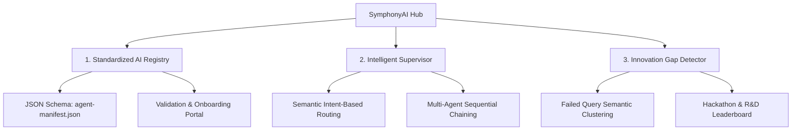
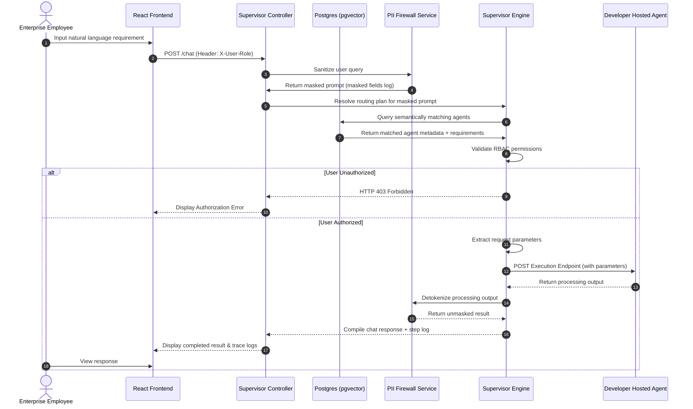

# PRODUCT UNDERSTANDING & SYSTEM ARCHITECTURE BLUEPRINT
## SymphonyAI: Enterprise AI Operating System & Multi-Agent Orchestration Hub

---

### Document Metadata
* **Status**: Approved / Baseline
* **Version**: 1.0.0
* **Target Audience**: Enterprise Architects, AI Engineering Lead, IT Security Officers, Product Managers
* **Author**: Antigravity AI Architect

---

## 1. Executive Summary & Problem Space

SymphonyAI is a centralized **Enterprise AI Marketplace, Orchestration, and Innovation Hub** designed to resolve organizational friction caused by the organic, decentralized adoption of custom employee-built AI tools ("Agent Sprawl").

### 1.1 The Enterprise Problem Statement
As departments independently deploy specialized Large Language Model (LLM) agents, the organization faces severe operational friction:
* **Agent Sprawl & Redundancy**: Multiple engineering pods build overlapping solutions (e.g., three separate legal parsers), wasting compute resources and duplicate engineering hours.
* **Discovery Friction**: Non-technical employees cannot easily find existing tools, resulting in low adoption of internally built AI assets.
* **Operational Blind Spots**: IT administrators lack visibility into backend agent health, usage statistics, token costs, and success rates.
* **Workflow Fragmentation**: Independent tools operate in silos. Users must manually copy-paste data between tools (e.g., un-nesting JSON output from a scraper to feed a translator).

### 1.2 Strategic Value Proposition
SymphonyAI unifies this ecosystem as a **single intelligent gateway**, providing:
1. A **Centralized Directory** where all employee-built tools publish capabilities via a uniform manifest schema.
2. A **Conversational Supervisor** that intercepts user queries, evaluates permissions, and routes payloads to single agents or coordinates multi-step sequential chains.
3. An **Innovation Backlog Engine** that parses telemetry data of failed queries and clusters them into distinct, high-value feature development queues.

---

## 2. Core Pillars of SymphonyAI



### 2.1 Pillar 1: The Standardized AI Registry
* **Purpose**: Registers and catalogues all enterprise-developed agents under a single, unified database schema.
* **Onboarding Mechanism**: AI creators submit their tools by uploading a standardized `agent-manifest.json` file.
* **Manifest Specifications**:
  * **Metadata**: Unique agent identifier, version tag, description.
  * **Endpoints**: Live REST URL endpoints for execution and health monitoring.
  * **Parameters**: Strict JSON Schema array defining parameter names, types, descriptions, and required constraints.
  * **Security**: Role-Based Access Control (RBAC) declarations specifying authorized roles (e.g., `["Admin", "HR"]`).

### 2.2 Pillar 2: The Intelligent Supervisor (Orchestration Engine)
* **Purpose**: Intercepts natural language requirements, extracts parameters, evaluates access permissions, and executes workflows.
* **Routing Logic**: Uses semantic vector embeddings (pgvector) to match user intent to registered agent descriptions.
* **Multi-Step Sequential Chaining**: Decomposes complex prompt requirements (e.g., *"summarize the contract and then translate it to French"*) into ordered tasks, automatically mapping the outputs of Step N as the inputs to Step N+1.

### 2.3 Pillar 3: Telemetry-Driven Gap Detection
* **Purpose**: Automatically turns failed searches and capability drops into actionable developer backlogs.
* **Clustering Mechanism**: Failed queries (where no semantic match score exceeds the 75% threshold) are stored in `failed_queries` logs. An offline background worker uses vector clustering to group these strings into distinct feature gaps (`innovation_gaps`), forming a leaderboard.

---

## 3. High-Level Technical Architecture

The following block diagram represents the end-to-end data flow, layout, and component boundaries:



### 3.1 Component Directory Structure
* **`symphony-backend`**: Spring Boot REST API, Postgres JpaRepository layer, flyway migrations, and supervisor routing.
* **`symphony-ui`**: Single-Page React App built with Vite, styled with a custom *Alabaster & Obsidian* design system, persistent left sidebar, and interactive sliding drawer overlays.

---

## 4. Governance & Enterprise Security Framework

To satisfy compliance regulations within large-scale enterprises, SymphonyAI enforces security at the gateway layer:

```
                  ┌────────────────────────────────────────┐
                  │          USER QUERY STREAM             │
                  └──────────────────┬─────────────────────┘
                                     │
                                     ▼
                  ┌────────────────────────────────────────┐
                  │          1. PII FIREWALL SCRUB         │
                  │  Masks SSNs, emails, credit cards      │
                  └──────────────────┬─────────────────────┘
                                     │
                                     ▼
                  ┌────────────────────────────────────────┐
                  │      2. SUPERVISOR INTERCEPTOR         │
                  │ Check X-User-Role vs agent.auth_roles  │
                  └──────────────────┬─────────────────────┘
                                     ├─────────────────────┐
                                     │ (Authorized)        │ (Unauthorized)
                                     ▼                     ▼
                  ┌─────────────────────────────────┐   ┌──────────────────┐
                  │ 3. TARGET AGENT RUNTIME EXEC    │   │ 403 FORBIDDEN    │
                  │ Forward sanitized payloads      │   │ Halted at edge   │
                  └─────────────────────────────────┘   └──────────────────┘
```

### 4.1 Role-Based Access Control (RBAC)
When an agent manifest specifies `requiresRBAC: true`, the gateway validates the incoming request header `X-User-Role`. If the user's role does not match one of the authorized values listed in the database, the execution halts with an HTTP 403 Forbidden response, ensuring sensitive tools (like corporate payroll) are shielded.

### 4.2 PII Protection Firewall
The [PiiFirewallService.java](file:///Users/shubhamverma/Documents/JavaProjects/startup/symphonyAI/symphony-backend/src/main/java/com/symphony/service/PiiFirewallService.java) executes regex pattern scans to intercept sensitive data before they exit the secure enterprise bounds:
* **Masking**: Replaces identified fields (SSNs, emails, credit card patterns) with randomly generated GUID placeholders.
* **Detokenization**: The gateway stores mappings in a thread-local transactional state and replaces placeholders with their original variables right before returning final compiled values to the authenticated client.

---

## 5. Success Metrics & Performance KPIs

To track the efficiency and ROI of the platform, leadership monitors four primary KPIs:

| KPI Category | Target Benchmark | Business Significance |
| :--- | :--- | :--- |
| **Routing Precision** | > 92% semantic matching | Minimizes agent mismatching and ensures high user trust in the supervisor portal. |
| **Discovery Reduction** | < 15 seconds to locate tool | Resolves search friction, replacing manuals and word-of-mouth recommendations. |
| **Compute Cost Savings** | > 30% reduction in duplication | Prevents redundant deployment fees for identical tools, consolidating API licensing. |
| **Development Lifecycle** | < 14 days from Gap to Onboard | Highlights corporate agility in responding to unaddressed user requirements surfaced on the dashboard. |

---

## 6. Phased Roadmap Summary

* **Phase 1: Registry Directory & Discovery UI**
  * Establish manifest onboarding endpoints.
  * Launch search engine and basic directory UI layout.
* **Phase 2: Intent-Based Routing & Analytics Telemetry**
  * Release single-step conversational Supervisor.
  * Activate PGVector failed search logging and live telemetry tables.
  * Surface unaddressed gap leaderboard.
* **Phase 3: Multi-Agent Chaining & Complete Governance**
  * Sequence multi-step pipelines conditionally.
  * Integrate PII firewall and RBAC role validation headers.
  * Deploy token cost accounting charts.
